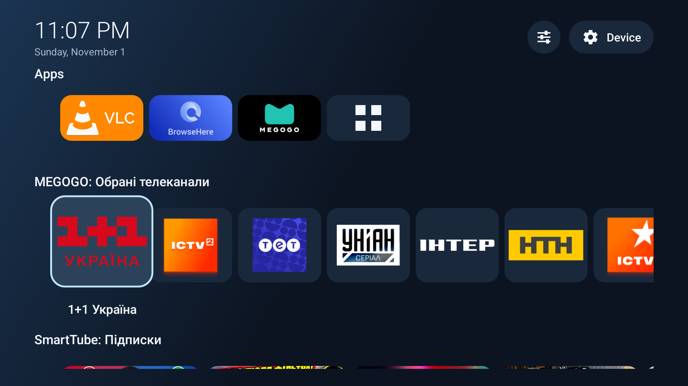

# Clear View Launcher

**Your apps' channel lists, together on your TV home screen.**

**Quick. Simple. Lightweight. Private. Open source.**

Unlike many Google TV launchers, Clear View Launcher supports channel lists just like the original Google TV launcher.

Keep your favourite apps close by, too, with a home screen built around what you want to watch.

Keep your favourites within reach and make room for the content you enjoy:

- **Channel lists on your home screen.** Bring lists from different compatible apps together, choose the ones you want and reorder their rows.
- **Quick and simple.** Reach your apps and channel lists with straightforward remote navigation and easy-to-use settings.
- **Lightweight by design.** A focused launcher for your TV essentials: apps, channel lists and a clear home screen.
- **Your apps, up front.** Choose your favourite TV apps, arrange them in your preferred order and open the rest from All apps.
- **Easy to see.** Browse artwork with a clear selection border, larger focused tiles and titles that appear as you move through them.
- **Made for your remote.** Use the directional buttons to browse and press OK to open an app or content item.
- **Simple to personalise.** Clean, simple design with clear, easy-to-use settings.

**Ad-free and private.** Clear View Launcher adds no advertising, requires no launcher account and collects no analytics. Your preferences stay on your TV. Content opens in the app that provides it, using that app's playback and account settings.

**Open source.** The code is available under the [MIT license](LICENSE), so you can inspect it, modify it and build it yourself.

Available channel lists depend on what your installed apps share with the home screen. Choose the lists you want to see and arrange them to suit your viewing habits.

**Install on your TV**

Requires **Android TV 14 or later**.

1. Copy the `ClearViewLauncher-0.7.10-release.apk` file to your TV using a USB drive or a file-transfer app.
2. Open the APK with a file manager on your TV. If prompted, allow that file manager to install unknown apps, then select **Install**.
3. Open **Clear View Launcher** from your TV's apps screen.
4. In the launcher's **Settings**, enable **Channel access**, then open **Channel lists** and add the lists you want to see.
5. Choose **Use as default launcher** if your TV supports changing its default launcher. Add your favourite apps in **Apps & favourites**.

**Your TV. Your favourites. A clear view.**

For installation commands and building from source, see the [development guide](docs/development.md). Technical details are available in the [architecture](docs/architecture.md) and [verification notes](docs/verification.md).

**License**

Released under the [MIT license](LICENSE). The software is provided **AS IS**, without warranty of any kind. See [LICENSE](LICENSE) for the full terms.
